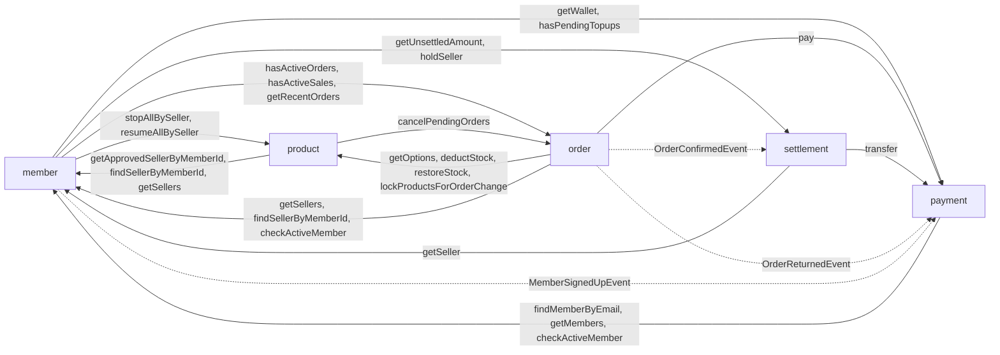

# 개발 가이드

팔레트 백엔드를 개발할 때 다섯 명이 똑같이 지킬 규칙을 정리한 문서입니다. 컨텍스트 간 계약(인터페이스·DTO·이벤트)의 초안은 [shared 계약](palette_shared_contract.md)에 있습니다.

- 구조: Facade · UseCase · Support, `in / app / domain / out`, 이벤트 리스너를 따릅니다.
- 관련 문서: [기획서](palette_proposal.md) · [정책](palette_policy.md) · [예외 처리](palette_exception_handling.md) · ERD(`palette.erd`)

## 1. 패키지 구조

```
com.backend
├── boundedContext
│   └── <ctx>                     # member, product, order, payment, settlement
│       ├── in                    # 컨트롤러, 이벤트 리스너, 스케줄러, DataInit, <Ctx>ApiAdapter
│       │   └── dto               #   요청·응답 DTO (이 컨텍스트 안에서만 사용)
│       ├── app                   # <Ctx>Facade, <Ctx><Verb>UseCase, <Ctx>Support
│       ├── domain                # 엔티티, 상태 enum, <Ctx>Policy, <Ctx>ErrorCode
│       └── out                   # Repository, 외부 연동 클라이언트(토스, 메일)
├── shared
│   ├── event                     # 모든 컨텍스트 공통 이벤트 규격(DomainEvent, EventEnvelope)
│   └── <ctx>                     # 다른 컨텍스트에 공개하는 계약
│       ├── dto                   #   record DTO, 공개 enum
│       ├── event                 #   이벤트 record
│       └── out                   #   <Ctx>Api 인터페이스
├── global                        # 공통 설정, BaseEntity, RsData, 예외, 이벤트 발행, 배치
└── standard                      # 유틸리티
```

| 레이어 | 하는 일 | 하지 않는 일 |
| --- | --- | --- |
| `in` | 요청을 받아 검증하고 Facade를 호출해 `RsData`로 응답 | 비즈니스 로직, 트랜잭션 |
| `app` | 유스케이스 흐름 조립, 트랜잭션 경계(Facade), 다른 컨텍스트 Api 호출 | HTTP·JSON 처리 |
| `domain` | 상태 전이 규칙, 금액 계산, 불변식 검사 | Repository·다른 컨텍스트 호출 |
| `out` | DB 접근, 외부 API 호출 | 비즈니스 판단 |

## 2. 이름 규칙

| 대상 | 규칙 | 예 |
| --- | --- | --- |
| Facade | `<Ctx>Facade` (컨텍스트당 1개, 유일한 진입점) | `OrderFacade` |
| 유스케이스 | `<Ctx><Verb><Noun>UseCase` (기능 1개 = 클래스 1개) | `OrderCreateOrderUseCase`, `PaymentPayUseCase` |
| 공통 조회 | `<Ctx>Support` (여러 UseCase가 함께 쓰는 조회) | `OrderSupport` |
| 컨트롤러 | `ApiV1<Name>Controller` | `ApiV1OrderController`, `ApiV1AdminOrderController` |
| 계약 인터페이스 | `shared/<ctx>/out/<Ctx>Api` | `ProductApi` |
| 계약 구현체 | `boundedContext/<ctx>/in/<Ctx>ApiAdapter` | `ProductApiAdapter` |
| 이벤트 | `<대상><과거형>Event`, record | `OrderConfirmedEvent` |
| DTO | 공개용 `<Name>Dto`, 요청 `<Name>Request`, 응답 `<Name>Response`, 동기 호출 입력 `<Name>Command`, 모두 record | `OptionSnapshotDto`, `PayCommand` |
| 오류 코드 | `<Ctx>ErrorCode` enum (`domain`에 둠) | `OrderErrorCode.ORDER_EXPIRED` |
| 정책 값 | `<Ctx>Policy` (`custom.*`에서 주입) | `OrderPolicy.EXPIRE_MINUTES` |

- 메서드 이름은 동사로 시작합니다. 조회는 `get`(없으면 예외), `find`(Optional 반환), `exists`·`has`(boolean)로 구분합니다.
- Javadoc과 주석은 한국어로 씁니다.

## 3. 공통 타입 규칙

| 항목 | 규칙 |
| --- | --- |
| ID | `Long` (ERD가 BIGINT). 생성 전략은 `@GeneratedValue(strategy = GenerationType.IDENTITY)` |
| 금액 | `long`, 원 단위 정수. `double`·`BigDecimal`은 쓰지 않음. 수수료는 `price * rate / 100`(곱셈 먼저, 버림) |
| 시간 | `LocalDateTime`만 사용(`Instant`·`ZonedDateTime`·`Date`는 쓰지 않음), **KST(Asia/Seoul) 기준**. JVM 기본 시간대를 `Asia/Seoul`로 고정(`Application.main`, `build.gradle.kts`의 `-Duser.timezone`). 배포 서버·Docker·CI는 기본이 UTC라서, 설정하지 않으면 정산월 경계와 `@Scheduled` 실행 시각이 9시간 어긋남 |
| 상태값 | enum + `@Enumerated(EnumType.STRING)`. 값은 [정책 상태 코드](palette_policy.md)와 같은 이름 |
| 컬럼·필드 이름 | 컬럼은 snake_case, 필드는 camelCase. 생성·수정 시각은 필드 `createdAt` · `updatedAt` → 컬럼 `created_at` · `updated_at` |
| 스키마 관리 | Flyway 마이그레이션(`src/main/resources/db/migration`)으로만 만들고 바꿉니다. `ddl-auto: validate`라서 엔티티와 DB가 다르면 앱이 시작되지 않습니다. 규칙은 [4.1 마이그레이션](#41-마이그레이션) |

## 4. 엔티티 규칙

- 모든 엔티티는 `BaseIdAndTime`을 상속합니다(`Long id`, `createdAt`, `updatedAt` 자동 기록).
- 테이블 이름은 **ERD 테이블 이름을 그대로** `@Table(name = "...")`로 지정합니다. 예: `Order` 엔티티 → `@Table(name = "market_order")`(`order`는 SQL 예약어). 컬럼 이름도 ERD를 따릅니다(camelCase 필드는 자동으로 snake_case 컬럼이 됨).
- **다른 컨텍스트의 엔티티를 `@ManyToOne`으로 참조하지 않습니다.** `Long buyerId`, `Long sellerId`처럼 ID만 저장합니다.
  - 같은 컨텍스트 안에서는 연관관계를 써도 됩니다(예: `Order` ↔ `OrderItem`).
  - 다른 컨텍스트의 값이 화면에 필요하면, 주문 항목처럼 그 시점 값을 복사(스냅샷)해 두거나 `<Ctx>Api`로 조회합니다.
- 상태 변경은 엔티티 메서드로만 합니다(`order.cancel(CancelType.USER)`). 메서드 안에서 현재 상태를 검사하고, 잘못된 전이면 `DomainException`을 던집니다.
- `@Setter`는 쓰지 않습니다. 생성은 생성자 또는 정적 팩토리(`Order.create(...)`)로 합니다.
- 다른 컨텍스트에 넘길 때는 엔티티에 `toDto()`를 두고 DTO로 변환합니다.

### 4.1 마이그레이션

엔티티의 테이블·컬럼·인덱스·제약을 바꾸면 같은 PR에 마이그레이션 파일을 함께 넣습니다.

- 위치와 이름: `src/main/resources/db/migration/V{번호}__{설명}.sql` (예: `V2__add_member_phone.sql`). 번호는 develop 기준 다음 번호입니다.
- **develop에 머지된 마이그레이션 파일은 고치지 않습니다.** 이미 실행된 DB가 있어서, 고치면 Flyway 체크섬 검증에 실패합니다. 바꿀 내용은 새 파일로 추가합니다. 머지 전 내 브랜치에만 있는 파일은 고쳐도 됩니다.
- 두 PR이 같은 번호를 쓰면 나중에 머지하는 쪽이 번호를 올립니다.
- **머지 직전에 최신 develop을 받아 내 마이그레이션 번호가 develop의 마지막 번호보다 큰지 다시 확인합니다.** 더 큰 번호가 먼저 개발 서버에 적용된 뒤 낮은 번호가 들어오면 Flyway 검증이 실패해 서버가 기동되지 않습니다. 번호가 밀렸으면 번호를 올린 뒤 머지합니다.
- 마이그레이션을 빠뜨리면 `Schema validation: missing column ...` 같은 오류로 앱과 테스트가 시작되지 않습니다.
- enum 컬럼에는 허용 값 CHECK 제약을 두지 않습니다. 값 검증은 `@Enumerated(STRING)`이 맡고, enum 값을 추가할 때마다 마이그레이션이 필요해지는 것을 피합니다.
- `columnDefinition = "CHAR(7)"`처럼 `String` 필드를 VARCHAR가 아닌 타입에 매핑하면 `@JdbcTypeCode(SqlTypes.CHAR)`도 함께 붙입니다. 없으면 `validate`가 VARCHAR를 기대해 실패합니다.
- Spring Batch 메타 테이블은 마이그레이션에 넣지 않고 `spring.batch.jdbc.initialize-schema`가 만듭니다.

## 5. 트랜잭션 규칙

- `@Transactional`은 **Facade 메서드에만** 붙입니다. 조회는 `@Transactional(readOnly = true)`입니다.
  - 컨트롤러에는 붙이지 않습니다.
- Facade는 **엔티티가 아니라 DTO를 반환**합니다. `open-in-view: false`라서 컨트롤러에서 지연 로딩을 하면 오류가 납니다.
- 예외적으로 별도 트랜잭션이 필요한 경우(결제 실패 기록 등)는 별도 빈에 `@Transactional(propagation = REQUIRES_NEW)`를 둡니다. 같은 클래스 안에서 호출하면 적용되지 않습니다. → [예외 처리 6.2](palette_exception_handling.md)
- 외부 호출을 트랜잭션 밖에 두려고 짧은 트랜잭션 구간을 별도 빈에 두는 경우도 예외입니다(예: 토스 충전 승인의 `PaymentTopupConfirmProcessor`, 이때 Facade 메서드에는 `@Transactional`을 붙이지 않음).
- 외부 호출(토스, 메일)은 DB 트랜잭션 밖에서 합니다.
- 경쟁이 생기는 상태 변경(결제 vs 만료)은 조건부 UPDATE(`where status in (...)`), 비관적 잠금(`findBy…ForUpdate`) 후 상태 확인, `@Version`으로 막습니다.
- 예치금 잔액을 바꿀 때는 `findByMemberIdForUpdate`로 지갑을 잠근 뒤 `WalletTransaction.record(...)`로 잔액 변경과 원장 생성을 함께 하고, 같은 트랜잭션에서 원장을 저장합니다. `Wallet.deposit()`·`withdraw()`를 직접 호출하지 않습니다.

## 6. 컨텍스트 간 통신

### 6.1 세 가지 방식

| 방식 | 언제 쓰나 | 구현 |
| --- | --- | --- |
| **동기 Api** | 결과가 바로 필요하거나 같은 트랜잭션이어야 할 때 | `shared/<ctx>/out/<Ctx>Api` 인터페이스 → 제공 컨텍스트의 `<Ctx>ApiAdapter`가 구현 |
| **이벤트** | 끝난 일을 알리고, 후속 처리가 실패해도 원래 요청은 성공이어야 할 때 | `shared/<ctx>/event` record → Outbox 저장 → 릴레이가 커밋 뒤 전달 (지금 있는 이벤트는 아직 바로 발행, [6.5](#65-outbox)) |

기획서가 같은 트랜잭션을 요구하므로(주문 생성 + 재고 차감, 결제 + 주문 PAID) 동기 호출은 Java 인터페이스로 합니다. MSA로 나눌 때는 `<Ctx>Api` 구현체만 `RestClient` 기반으로 바꾸면 됩니다.

### 6.2 동기 Api 규칙

```java
// shared/product/out/ProductApi.java — 계약 (다른 컨텍스트는 이것만 import)
public interface ProductApi {
    void deductStock(List<StockChangeDto> items);
}

// boundedContext/product/in/ProductApiAdapter.java — 구현 (상품 담당자 소유)
@Component
public class ProductApiAdapter implements ProductApi {
    private final ProductFacade productFacade;

    public ProductApiAdapter(@Lazy ProductFacade productFacade) {   // 순환 참조 방지
        this.productFacade = productFacade;
    }

    @Override
    public void deductStock(List<StockChangeDto> items) {
        productFacade.deductStock(items);   // Facade의 @Transactional(REQUIRED)이 호출한 쪽 트랜잭션에 참여
    }
}
```

- 다른 컨텍스트는 `shared.*`만 import합니다. `boundedContext.<다른 ctx>.*`를 import하면 안 됩니다.
- Adapter는 Facade를 호출하는 일만 합니다. 로직은 UseCase에 둡니다.
- **Adapter는 Facade를 `@Lazy`로 주입합니다.** 상품 ↔ 주문, 회원 ↔ 주문처럼 서로 호출하는 컨텍스트가 있어서, 그냥 주입하면 앱이 시작할 때 순환 참조 오류가 납니다.
  - Lombok `@RequiredArgsConstructor`를 쓰려면 `lombok.config`에 `lombok.copyableAnnotations += org.springframework.context.annotation.Lazy`를 추가합니다.
- 실패는 `DomainException`으로 던집니다. 단, 호출한 쪽이 결과를 보고 판단해야 하는 실패(잔액 부족 등)는 결과 DTO로 반환합니다. 어느 쪽인지는 인터페이스 Javadoc에 적습니다.
- 파라미터와 반환값은 `shared` DTO와 기본 타입만 씁니다. 엔티티를 넘기지 않습니다.
- 구현이 아직 없으면 제공하는 쪽이 Adapter에 임시 구현(고정값 반환 또는 `UnsupportedOperationException`)을 먼저 넣어 둡니다. 다른 사람이 Fake 빈을 따로 만들면 빈이 두 개가 됩니다.

### 6.3 호출 방향



실선은 동기 Api, 점선은 이벤트입니다(outbox에 기록하지만 아직 릴레이로 옮기지 않아 바로 발행, `MemberSignedUpEvent`는 같은 트랜잭션에서 처리. [6.5](#65-outbox)). 결제(payment)는 관리자 결제·충전 조회의 회원 이메일 검색·표시를 위해 `MemberApi`만 호출합니다.

### 6.4 이벤트 규칙

```java
// shared/order/event/OrderConfirmedEvent.java
public record OrderConfirmedEvent(Long orderId, Long buyerId, LocalDateTime confirmedAt,
                                  ConfirmType confirmType, List<ConfirmedOrderItemDto> items) implements DomainEvent {
    @Override public String aggregateType() { return "ORDER"; }
    @Override public Long aggregateId() { return orderId; }
}

// boundedContext/settlement/in/SettlementEventListener.java
@Component
@RequiredArgsConstructor
public class SettlementEventListener {
    private final SettlementFacade settlementFacade;

    @TransactionalEventListener(phase = AFTER_COMMIT)
    @Transactional(propagation = REQUIRES_NEW)
    public void handle(OrderConfirmedEvent event) {
        settlementFacade.createCandidates(event);
    }
}
```

- 이벤트는 불변 record로 만들고, 받는 쪽이 다시 조회하지 않아도 되도록 필요한 값을 모두 담습니다.
- 다른 컨텍스트에 알리는 이벤트는 `shared.event.DomainEvent`를 구현합니다. `aggregateType()`은 이벤트가 생긴 대상 종류(대문자 단수형, 예: `ORDER`, `MEMBER`), `aggregateId()`는 그 대상의 ID입니다. record 필드에는 넣지 않습니다.
- 리스너는 Facade 한 줄만 호출합니다. 지금은 `AFTER_COMMIT` + `REQUIRES_NEW`를 씁니다.
  - 예외: 정책상 발행한 쪽과 같은 트랜잭션이어야 하는 이벤트(`MemberSignedUpEvent`)는 `@EventListener`로 받고, 트랜잭션은 Facade의 `@Transactional`에 맡깁니다.
  - 릴레이로 옮긴 이벤트의 리스너는 `@EventListener` + `@Transactional`을 씁니다. 릴레이가 이벤트마다 연 트랜잭션에 참여하므로, 리스너가 실패하면 리스너의 변경과 PUBLISHED 표시가 함께 롤백되고 이벤트가 다시 전달됩니다. 릴레이로 옮긴 뒤에도 `AFTER_COMMIT` + `REQUIRES_NEW`로 두면 실패한 이벤트가 재시도되지 않고 유실됩니다([6.5](#65-outbox)).
- **같은 이벤트를 두 번 받아도 결과가 같아야 합니다(멱등).** 유니크 제약(`settlement_candidate.order_item_id`, 환불 구현 시 `payment_refund.payment_id`)으로 중복을 막습니다.
- 발행은 UseCase에서 `EventPublisher.publish(...)`로 합니다. 엔티티에서 스프링 빈을 꺼내 쓰지 않습니다.
- `publish()`는 **쓰기 트랜잭션 안에서만** 부릅니다. 이벤트를 호출한 쪽 트랜잭션에서 `outbox_event`에 저장하므로, 트랜잭션이 없거나 읽기 전용이면 `IllegalStateException`이 납니다.

### 6.5 Outbox

이벤트는 Transactional Outbox로 발행합니다(TRSS-121). 비즈니스 변경과 이벤트 저장을 한 트랜잭션으로 묶어, 커밋된 변경의 이벤트가 유실되지 않게 합니다.

- 리스너 전환은 받는 쪽 담당자가 합니다. 전환 전 이벤트는 `EventPublisher.DIRECT_PUBLISH_EVENTS`에 두어, outbox에 PUBLISHED로 기록만 하고 Outbox 도입 전처럼 바로 스프링 이벤트로 발행합니다(리스너 동작은 도입 전과 같음).
- 지금은 `MemberSignedUpEvent`, `OrderConfirmedEvent` 둘 다 이 목록에 있어서, 릴레이가 실제로 전달하는 이벤트는 아직 없습니다.

| 단계 | 내용 | 상태 |
| --- | --- | --- |
| 1 | 이벤트 봉투 규격: `shared.event.DomainEvent`, `shared.event.EventEnvelope` | 완료 |
| 2 | `outbox_event` 테이블 (`V12`), 엔티티 `global.outbox.OutboxEvent` | 완료 |
| 3 | `EventPublisher.publish()`가 호출한 쪽 트랜잭션 안에서 outbox에 저장 (트랜잭션 밖 호출은 예외) | 완료 |
| 4 | 릴레이: 미발행 이벤트를 스프링 이벤트로 발행 (`OutboxRelay`, `OutboxRelayScheduler`) | 완료 |
| 4-1 | `OrderConfirmedEvent` 릴레이 전환: `SettlementEventListener`를 `@EventListener` + `@Transactional`로 바꾸고 `EventPublisher.DIRECT_PUBLISH_EVENTS`에서 뺀다 | settlement 담당 |
| 4-2 | `MemberSignedUpEvent` 릴레이 전환: 결제가 지갑이 아직 없는 구간을 처리(조회는 0, 쓰기는 지갑을 먼저 생성)하고, `PaymentEventListener`에 `@Transactional`을 붙인 뒤 `DIRECT_PUBLISH_EVENTS`에서 뺀다 | payment 담당 |
| 5 | Kafka 발행 | 도입 승인 후 |

`EventEnvelope`는 모든 이벤트에 붙는 공통 봉투입니다. outbox 한 행, Kafka 메시지 하나와 1:1로 대응합니다.

| 필드 | 타입 | 내용 |
| --- | --- | --- |
| `eventId` | `UUID` | 이벤트 고유 ID. 받는 쪽이 중복을 거르는 기준 |
| `eventType` | `String` | payload record의 클래스 단순 이름(예: `OrderConfirmedEvent`) |
| `occurredAt` | `LocalDateTime` | 발행 시각(KST) |
| `aggregateType` | `String` | `DomainEvent.aggregateType()` |
| `aggregateId` | `Long` | `DomainEvent.aggregateId()`. Kafka 도입 시 메시지 키 |
| `payload` | `DomainEvent` | 기존 이벤트 record 그대로 |

- 봉투는 `EventEnvelope.wrap(event)`로 만듭니다. 새 `eventId`와 현재 시각이 채워집니다.

`outbox_event` 테이블은 봉투 하나를 한 행으로 저장합니다.

| 컬럼 | 내용 |
| --- | --- |
| `event_id` (uuid, 유니크) · `event_type` · `occurred_at` · `aggregate_type` · `aggregate_id` | 봉투 값 그대로 |
| `payload` (jsonb) | payload record를 JSON으로 바꾼 값 |
| `status` | `PENDING`(발행 전) → `PUBLISHED`(발행함) / `FAILED`(재시도 한도 초과) |
| `retry_count` | 발행 실패 횟수 |
| `published_at` | 발행 시각 |

- 릴레이는 `status = 'PENDING'` 부분 인덱스(`idx_outbox_event_pending`)로 미발행 행만 `id` 순서대로 가져옵니다.

릴레이(`global.outbox.OutboxRelay`, 스케줄러 `OutboxRelayScheduler`)

- `custom.outbox.relayIntervalMillis`(1초)마다 PENDING 이벤트를 최대 `relayBatchSize`(100)개 발행합니다. 이벤트가 리스너에 닿기까지 최대 이 간격만큼 늦어집니다.
- 이벤트 하나마다 트랜잭션을 열고 `SELECT ... FOR UPDATE SKIP LOCKED`로 한 행을 잠근 뒤, payload를 `eventType`의 클래스로 되돌려 스프링 이벤트로 발행하고 PUBLISHED로 바꿉니다. 서버가 여러 대여도 같은 이벤트를 동시에 두 번 발행하지 않습니다.
- 리스너가 실패하면 그 트랜잭션은 롤백되고, 별도 트랜잭션에서 `retry_count`를 올립니다. 이번 실행에서는 다음 이벤트로 넘어가고 다음 실행에서 다시 시도합니다. `maxRetryCount`(5)번 실패하면 FAILED로 두고 에러 로그를 남깁니다(FAILED는 사람이 확인).
- 릴레이가 아는 이벤트 클래스는 `com.backend.shared` 안의 `DomainEvent` 구현체입니다. 클래스 단순 이름이 겹치면 앱이 시작하지 않습니다.
- 통합 테스트는 `custom.scheduling.enabled=false`로 스케줄러를 끄고, 필요하면 `OutboxRelay.relayPending()`을 직접 부릅니다.

- 구매 확정과 `OrderConfirmedEvent` 발행은 주문 컨텍스트의 메서드 하나로 묶고, 확정 경로 3개(수동·7일 자동·반품 거절)가 모두 그 메서드를 호출합니다 → [공유 계약 7.3](palette_shared_contract.md)

## 7. API·컨트롤러 규칙

- 경로: `/api/v1/...`, 판매자 `/api/v1/seller/**`, 관리자 `/api/v1/admin/**`
- 응답: 성공·실패 모두 `RsData { resultCode, msg, data }`. 컨트롤러는 `RsData`를 그대로 반환하고 `ResponseEntity`로 감싸지 않습니다 → [예외 처리](palette_exception_handling.md)
  - 성공: 조회·생성·처리 모두 HTTP 200, `resultCode`는 `200-1` 하나만 씁니다(`201`·`202` 구분 없음, 예외: 판매자 신청 `POST /sellers`는 201·`201-1`). 완료·처리 중처럼 구분이 필요하면 `data.status`로 나눕니다
  - 실패: `{HTTP 상태}-{ERROR_NAME}`(예: `409-ORDER_EXPIRED`), HTTP 상태는 `GlobalExceptionHandler`가 맞춥니다
- 요청 DTO는 record + Bean Validation(`@NotBlank`, `@Positive` 등), 컨트롤러 파라미터에 `@Valid`
- Swagger: 컨트롤러에 `@Tag`, 메서드에 `@Operation(summary = "...")`
- **로그인 회원 꺼내기:** 컨트롤러는 아래 한 가지 방식만 씁니다.
  ```java
  @GetMapping("/orders")
  public RsData<...> getOrders(@AuthenticationPrincipal AuthMember authMember) {
      Long memberId = authMember.memberId();   // role: authMember.role()
      ...
  }
  ```
  - `AuthMember(memberId, role)`는 `global/security`에 있고, JWT 필터가 Access Token에서 꺼내 넣습니다.
  - 판매자 승인 상태처럼 바뀔 수 있는 값은 토큰에 없으므로, 판매 기능은 요청마다 DB에서 다시 확인합니다.
- **인가 규칙:** 권한 검사는 세 가지로 나눕니다.
  | 구분 | 무엇을 막나 | 어디서 |
  | --- | --- | --- |
  | 역할 (수직) | 구매자가 관리자 API, 관리자가 판매자·구매자 API 호출 | `SecurityConfig`의 URL 규칙. 역할은 USER·ADMIN 두 가지 |
  | 판매자 상태 | 승인되지 않은(심사 중·철회·제재) 판매자의 판매 기능 | 판매 기능 UseCase에서 `MemberApi.getApprovedSellerByMemberId`(다른 컨텍스트) 또는 `Seller`의 상태 확인(회원 컨텍스트). 아니면 `403-SELLER_NOT_APPROVED`. 상품 관리는 조회(내 상품 목록·상품 수정 화면·재고 이력)도 APPROVED를 확인하고, 판매 주문 항목·정산 조회는 `MemberApi.findSellerByMemberId`로 판매자 정보만 확인한다(제재·철회된 판매자도 지난 기록 조회 가능) |
  | 소유자 (수평) | 구매자 A가 구매자 B의 주문·충전, 판매자 A가 판매자 B의 상품·정산서 조회·수정 | 경로에 리소스 ID를 받는 UseCase에서 **조회 조건에 소유자를 넣는다**(`findByIdAndBuyerId` 등). 없으면 404 → [예외 처리 5.1](palette_exception_handling.md) |
  - `/me` 경로처럼 `AuthMember`의 회원 ID로만 조회하는 API는 소유자 검사가 따로 필요 없습니다.
  - **구매자 API 경로를 추가하면 `SecurityConfig`의 `BUYER_API_URLS`도 갱신합니다.** 목록에 없는 경로는 `authenticated()`만 걸려 관리자도 호출할 수 있습니다. 예를 들어 회원 탈퇴(`DELETE /api/v1/users/me`)는 관리자가 호출하면 수수료를 받는 계정이 사라지므로 따로 `USER`만 허용합니다.
  - 판매자 여부를 역할(`SELLER`)로 두지 않는 이유: 승인·제재·철회 때마다 역할을 바꾸고 토큰을 다시 발급해야 하고, 제재된 판매자가 남은 토큰 시간 동안 판매 기능을 쓸 수 있기 때문입니다.
  - **컨트롤러 테스트(`@WebMvcTest`)에서 Security 쓰기**
    - `@WebMvcTest`는 컨트롤러 주변만 띄우므로 Security 설정과 JWT 빈 5개를 `@Import`로 넣습니다.
    - 토큰은 `JwtTokenProvider.createAccessToken(memberId, role)`로 만들어 `Authorization: Bearer` 헤더에 넣습니다.
    - 테스트 의존성 `spring-boot-starter-security-test`가 필요합니다(`build.gradle.kts`에 추가되어 있음).
    ```java
    @WebMvcTest(ApiV1OrderController.class)
    @Import({SecurityConfig.class, JwtTokenProvider.class, JwtAuthenticationEntryPoint.class,
            JwtAccessDeniedHandler.class, SecurityErrorResponseWriter.class})
    class ApiV1OrderControllerTest {

        @Autowired
        private MockMvc mockMvc;

        @Autowired
        private JwtTokenProvider jwtTokenProvider;

        @MockitoBean
        private OrderFacade orderFacade;

        @Test
        void getOrders() throws Exception {
            String token = jwtTokenProvider.createAccessToken(1L, MemberRole.USER);   // 관리자는 MemberRole.ADMIN (판매자는 역할이 아니라 판매자 상태로 판단)

            mockMvc.perform(get("/api/v1/orders").header("Authorization", "Bearer " + token))
                    .andExpect(status().isOk());
        }

        @Test
        void getOrders_unauthorized() throws Exception {
            mockMvc.perform(get("/api/v1/orders"))
                    .andExpect(status().isUnauthorized())
                    .andExpect(jsonPath("$.resultCode").value("401-UNAUTHORIZED"));
        }
    }
    ```
    - 컨트롤러가 `@AuthenticationPrincipal AuthMember`로 받는 값은 토큰을 만들 때 넣은 `memberId`, `role`입니다.
    - 컨트롤러가 다른 빈(`@Component`)을 주입받으면 그 빈도 `@Import`에 추가하거나 `@MockitoBean`으로 대신합니다.

## 8. 예외

- 규칙은 [예외 처리 가이드](palette_exception_handling.md)를 따릅니다.
- 컨텍스트마다 `domain/<Ctx>ErrorCode` enum을 만들고 `throw new DomainException(OrderErrorCode.ORDER_EXPIRED)`로 던집니다.
- 남의 리소스 접근은 404(`findByIdAndBuyerId` 등으로 조회), 역할·판매자 상태 위반은 403입니다.

## 9. 설정과 정책 값

### 9.1 설정 파일과 환경변수

| 위치 | 넣는 것 | Git |
| --- | --- | --- |
| `application.yaml` | 모든 환경 공통 설정, 정책 값(`custom.*`). 비밀값은 `${환경변수}`로만 참조 | 올림 |
| `application-local.yaml` | 팀 공통 로컬 전용 설정(SQL 로그 등). `local` 프로필에서만 적용 | 올림 |
| `.env` | 비밀값과 개인 환경 값. 형식은 `.env.example` 참고 | **올리지 않음** |

- 비밀값(키, 비밀번호)은 `application.yaml`·`application-local.yaml`에 기본값으로도 쓰지 않습니다. 저장소가 공개 상태입니다.
- `.env` 필수 항목: `JWT_SECRET`, `ACCOUNT_ENCRYPTION_PASSWORD`, `ACCOUNT_ENCRYPTION_SALT`. 로컬 값은 팀에 따로 공유된 값을 쓰고, 없으면 `Could not resolve placeholder '...'` 오류로 앱과 테스트가 시작되지 않습니다.
- 로컬 실행은 공유된 IntelliJ 실행 구성 `Application (local)`(`.run/Application.run.xml`, Active profiles: `local`)을 씁니다. Spring Boot 실행 구성이라 IntelliJ Ultimate가 필요하고, 직접 만들 때도 Active profiles에 `local`을 넣습니다. 터미널에서는 실행할 때마다 `SPRING_PROFILES_ACTIVE=local ./gradlew bootRun`으로 실행합니다.

### 9.2 정책 값

정책 숫자는 코드에 직접 쓰지 않고 `application.yaml`의 `custom.*`에 둔 뒤 `<Ctx>Policy`로 읽습니다.

```yaml
custom:
  order:
    expireMinutes: 15          # 주문 생성 후 결제 제한 시간
    autoConfirmDays: 7         # 결제 후 자동 구매 확정
  payment:
    topupUnit: 10000           # 충전 단위·최소 금액
    topupMax: 1000000
    adminMemberId: 1           # 수수료(FEE)를 받는 관리자 지갑
  settlement:
    feeRate: 10                # 수수료율(%)
    payDayOfMonth: 10          # 매월 정산일
    maxAttempts: 3             # 최초 1회 + 재시도 2회
    retryIntervalMinutes: 10
```

## 10. 목록 조회

- 요청 파라미터: `page`(0부터), `size`(기본 20, 최대 100. 상품 검색 `GET /products`만 최대 50)
- 응답 `data` 형식:

```json
{
  "resultCode": "200-1",
  "msg": "주문 목록을 조회했습니다.",
  "data": {
    "items": [ { "orderId": 123 } ],
    "page": 0,
    "size": 20,
    "totalElements": 57,
    "totalPages": 3
  }
}
```

- 공통 record `PageResponse<T>(List<T> items, int page, int size, long totalElements, int totalPages)`를 `global`에 두고, `PageResponse.from(Page<T>)`로 변환합니다.

## 11. 초기 데이터

각 컨텍스트의 `<Ctx>DataInit`(`ApplicationRunner`)이 개발용 데이터를 넣습니다. 데이터가 이미 있으면 아무것도 하지 않습니다(멱등).

| `@Order` | DataInit | 넣는 데이터 |
| --- | --- | --- |
| 1 | `MemberDataInit` | **1번 관리자, 2번 판매자(APPROVED), 3번 구매자** + 각자 지갑 (ID 고정, `adminMemberId: 1`과 연결) |
| 2 | `ProductDataInit` | 카테고리(뷰티/의류 + 소분류), 2번 판매자의 상품 몇 개 |
| 3 | `PaymentDataInit` | 3번 구매자의 결제 완료 건·HELD 홀딩(정산 시드 주문 -1·-2용, 잔액·원장 변화 없음, `MEMBER_SEED_PASSWORD`가 있을 때만) |
| 4 | `OrderDataInit` | (필요하면) 테스트 주문 |
| 5 | `SettlementDataInit` | (필요하면) 정산 후보 |

## 12. 테스트

- 도메인 규칙(상태 전이, 금액 계산)은 스프링 없이 단위 테스트로 검증합니다.
- UseCase 테스트에서 다른 컨텍스트 Api는 Mockito mock 또는 테스트용 Fake로 대신합니다.
- 컨텍스트를 넘나드는 흐름(주문 → 결제 → 확정 → 정산)은 `@SpringBootTest` 통합 테스트로 확인합니다. 로컬 Docker PostgreSQL을 쓰고, 스키마는 앱과 같이 Flyway로 만들어집니다. `.env`의 필수 항목이 있어야 합니다.
- 동시성(결제 vs 만료, 재고 차감)은 `ExecutorService`로 동시에 요청하는 테스트를 하나 이상 둡니다.

## 13. 협업 규칙

- 브랜치: `main` ← `develop` ← `{type}/TRSS-{이슈번호}-{설명}`
- PR을 올리기 전에 최신 `develop`을 가져오고(`git merge origin/develop`) `./gradlew build`가 통과하는지 확인합니다.
- `global`, `shared`, `application.yaml`, 마이그레이션 파일을 바꾸는 PR은 팀 전체 리뷰를 받습니다. 모두가 의존하는 파일이기 때문입니다.
- `shared` 계약을 바꿀 때는 그 Api를 호출하는 사람에게 먼저 알립니다.

## 14. 결정 사항과 남은 것

**결정함**

- [x] 스키마 관리: Flyway 마이그레이션 + `ddl-auto: validate` (4.1)
- [x] 시간대: KST(`Asia/Seoul`)
- [x] ID 생성: `IDENTITY`
- [x] 생성·수정 시각 필드: `createdAt`, `updatedAt`
- [x] Adapter `@Lazy` 주입: `lombok.config`에 한 줄 추가
- [x] 시드 계정: 1 관리자, 2 판매자, 3 구매자
- [x] Facade는 DTO를 반환
- [x] Outbox: 도입함(TRSS-121, 6.5). 리스너 전환은 받는 쪽 담당자가 함(정산: `OrderConfirmedEvent`, 결제: `MemberSignedUpEvent`). `MemberSignedUpEvent`도 옮기기로 함(2026-10-23 결정), 지갑이 아직 없는 구간 처리는 payment 담당
- [x] 미정산 금액: 구매 확정된 금액만 (확정 전 주문은 포함하지 않음)
- [x] 목록 조회 형식: 10장
- [x] 결제 `PROCESSING`: 쓰지 않아 제거 (결제 건은 PAID·FAILED_*로만 저장)

**남은 것**

- [x] 로그인 회원 꺼내는 방식: `@AuthenticationPrincipal AuthMember` (7장)
- [ ] 감사 로그 기록 방식 (팀 논의 후 결정)
