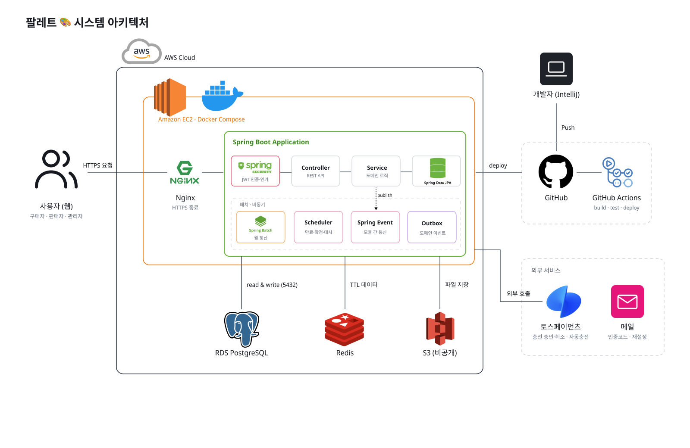

# 프로젝트 기획서

## 1. 프로젝트 소개

### 1.1 프로젝트 이름

**팔레트**

### 1.2 판매하는 상품(서비스)

다채로운 컬러를 한 곳에 담은 팔레트처럼, 다양한 셀러의 뷰티·의류 상품으로 나만의 취향과 스타일을 완성하는 입점형 이커머스 플랫폼이다.

플랫폼은 중개·결제·정산을 담당하며, 토스페이먼츠 연동 예치금 시스템과 월 정산(수수료 10%) 구조를 통해 구매자와 판매자 모두에게 안정적인 거래 환경을 제공한다.

| 대분류 | 소분류 |
| --- | --- |
| 뷰티 | 메이크업, 바디케어, 선케어, 마스크팩, 클렌징, 스킨케어, 헤어케어, 건강식품 |
| 의류 | 상의, 아우터, 바지, 원피스/스커트, 신발, 가방, 모자, 소품 |

- 핵심 서비스 정책
    - 상품은 옵션 없는 단일 품목이고, 금액은 원 단위 정수다.
    - 모든 주문은 **예치금**으로 결제하고, 예치금은 토스페이먼츠로 충전한다(10,000원 단위, 1회 1만~100만 원).
    - 한 주문에 여러 판매자의 상품을 담을 수 있고, 주문 상태는 주문서 하나에 하나만 둔다.
    - 결제 금액은 구매 확정 전까지 플랫폼이 보관(홀딩)하고, 확정된 금액을 다음 달 10일 판매자 예치금 지갑에 정산한다.
    - 픽업·배송은 이번 범위에서 제외한다(추후 추가 예정).

### 1.3 주요 기능

| 기능 | 사용자 | 핵심 내용 | 세미 프로젝트 개발 범위 |
| --- | --- | --- | --- |
| 회원/인증 | 비회원, 회원 | 이메일 인증 가입, 지갑 자동 생성, JWT 로그인, 회원 탈퇴 | 포함 |
| 판매자 | 회원, 관리자 | 판매자 입점 신청, 관리자 승인(판매자 상태 APPROVED), 철회 요청·관리자 제재, 계좌/상품 관리 | 포함 |
| 관리자 | 관리자 | 판매자 심사·제재, 상품 판매 중지·중지 요청 심사, 결제·실패 거래 조회, 반품 승인, 수동 정산 | 포함 |
| 상품·카테고리·재고 | 판매자, 관리자 | 상품 등록·수정·삭제, 판매 중지(해제 없음), 2단계 카테고리, 재고 조정 및 변경 이력 관리 | 포함 |
| 검색 | 모두 | 상품명·카테고리 검색, 최신/가격순 정렬, 품절 상품 제외 | 포함 |
| 장바구니 | 회원 | 여러 판매자 상품 담기, 수량·선택 변경, 조회 시 가격·재고 재확인, 예상 결제 금액 | 포함 |
| 주문·취소·반품·구매확정 | 회원, 관리자 | 주문 생성 시 재고 차감(생성 후 15분 미결제 시 만료), 결제 전 취소, 반품 심사(1회), 결제 후 7일 자동 확정 | 포함 |
| 예치금·결제 | 회원 | 토스 예치금 충전, 지갑 → 홀딩 결제, 미사용 충전 건 취소, 반품 환불 (충전 취소·반품 환불은 미구현) | 포함 |
| 월 정산 | 판매자, 관리자 | 구매 확정 시 정산 후보 생성, 매월 10일 정산(Spring Batch), 수수료 10% 차감 지급, 재시도·수동 정산 | 포함 |

**회원/인증**

- 가입 순서는 이메일 중복 확인 → 6자리 인증코드(5분 유효) → 가입이며, 회원과 예치금 지갑을 한 트랜잭션으로 만든다
- 휴대폰 번호는 판매자에게만 받고, 휴대폰 본인인증 절차는 진행하지 않는다
- 로그인은 Access Token 30분, Refresh Token 14일(재발급 시 회전)이다
- 역할은 USER·ADMIN이며 인증 실패는 401, 권한 부족은 403으로 구분한다. 판매자는 역할이 아니라 판매자 상태로 구분한다
- 탈퇴는 진행 중인 주문, 미정산 금액, 예치금 잔액이 모두 0일 때만 가능하고, 탈퇴 시 개인정보를 비식별화한다
    - 예치금이 남아 있으면 탈퇴를 거절하고, 미사용 충전 건은 충전 취소로 환불받도록 안내한다
    - 탈퇴 시 시스템 차원의 자동 환불은 하지 않는다
- 회원 상태는 ACTIVE·DELETED를 쓴다

**판매자**

- 사업자번호·상호명·대표자명·연락처·정산 계좌(은행·계좌번호·예금주)를 받아 신청하고, 관리자가 승인하면 판매자 상태가 APPROVED가 되어 판매 기능을 쓸 수 있다
- 상태는 PENDING → APPROVED/REJECTED, 철회는 APPROVED → WITHDRAW_REQUESTED → WITHDRAWN(거절 시 APPROVED), 제재는 APPROVED·WITHDRAW_REQUESTED → SANCTIONED이다
    - REJECTED·WITHDRAWN은 같은 신청 API로 재신청하면 PENDING으로 돌아가고, SANCTIONED는 재신청할 수 없다
- 판매자 정보는 회원당 1개이며, 사업자번호는 심사 중·판매 중·철회 심사 중·제재된 판매자와 겹칠 수 없다(반려·본인 철회 시 비워져 재사용 가능)
- 판매 기능은 판매자 상태가 APPROVED일 때만 쓸 수 있다(요청마다 DB에서 확인)
- 판매자도 일반 회원처럼 구매할 수 있다. 단, 본인 상품은 장바구니에 담거나 주문할 수 없다
- 판매자 정산금은 해당 회원의 기존 예치금 지갑에 지급하며, 판매자는 정산받은 예치금으로 상품을 구매할 수 있다
- **판매자 스스로 철회:** 철회 요청(WITHDRAW_REQUESTED) → 관리자 승인 → WITHDRAWN
    - 미정산 금액이 있으면 철회를 요청할 수 없고, 없으면 일반 사용자로 전환한다(판매 불가, 구매 가능)
    - 관리자 승인 시 진행 중인 판매 주문(CREATED·PAYMENT_FAILED·PAID·RETURN_REQUESTED)이나 미정산 금액이 있으면 승인하지 않는다
    - 철회를 요청하면 판매 중인 상품을 모두 판매 중지하고 결제 대기 주문을 취소·재고 복원한다. 거절하면 철회로 중지된 상품만 다시 판매한다
- **관리자 제재:** 관리자가 판매자를 바로 SANCTIONED로 전환한다
    - 판매자 상태를 SANCTIONED로 바꾼다(회원 역할은 USER 그대로, 사업자번호는 유지해 재신청을 막는다)
    - 결제 완료(PAID)된 주문은 그대로 진행하고, 결제 대기(CREATED·PAYMENT_FAILED) 주문은 취소하고 재고를 복원한다
    - 판매자의 상품은 모두 판매 중지(STOPPED)하고, 정산은 HOLD로 두어 지급하지 않는다

**상품·카테고리·재고·검색**

- 상품 상태는 ON_SALE·STOPPED·DELETED를 저장하고, 품절(SOLD_OUT)은 저장하지 않고 옵션 재고로 계산해 보여 준다
- 상품 등록 시 필수 항목은 상품명, 가격, 카테고리, 상품 설명, 초기 재고, 대표 이미지이며 상세 이미지는 선택(최대 10개)이다
- 판매 중지는 판매자와 관리자만 할 수 있으며 중지 사유를 반드시 적는다
    - 판매자는 판매 중지를 요청하고, 관리자가 사유를 검토해 승인하거나 반려한다 (상품마다 심사 중인 요청은 하나, 심사 중 상품이 삭제·중지되면 요청은 자동으로 닫힌다)
    - 관리자는 사유를 적고 바로 판매 중지한다
    - 판매 중지 해제 기능은 제공하지 않는다
- 상품이 STOPPED·DELETED가 되면 그 뒤로는 장바구니 담기와 주문 생성이 불가능하다
    - 이미 결제된(PAID 이후) 주문은 그대로 진행하고, 결제 대기 주문은 취소하고 재고를 복원한다
- 재고는 옵션 단위로 증감량만 입력해 조정하고(사유 없음) 모든 변화를 재고 이력에 남긴다(INIT, ADJUST, ORDER_DEDUCT, ORDER_RESTORE, RETURN_RESTORE)
- 카테고리는 대분류(뷰티/의류)-소분류 2단계이며 관리자만 관리한다
- 검색은 상품명 부분 일치, 카테고리 필터, 최신순·가격순 정렬, 품절 제외(기본 켜짐)를 지원한다

**장바구니·주문**

- 장바구니는 가격·재고를 보장하지 않고, 조회할 때마다 현재 가격·상태를 다시 계산해 예상 결제 금액을 보여 준다
- 장바구니에는 여러 판매자의 상품을 담을 수 있고, 수량은 1~99이며 같은 상품은 수량을 합산한다
- 상품 추가·삭제·수량 변경은 장바구니에서만 한다. 주문이 생긴 뒤에는 결제하거나 전체 취소하는 것만 할 수 있다
- 장바구니 항목은 주문 결제가 완료되는 시점에 삭제한다(주문에 포함된 항목만)
- 결제 대기 주문(CREATED·PAYMENT_FAILED)에 들어 있는 장바구니 항목으로는 새 주문을 만들 수 없다
- 주문 생성 때 가격·상품·판매자 정보를 스냅샷으로 고정하고 재고를 차감(예약, ORDER_DEDUCT)한다
- 주문 상태는 CREATED, PAYMENT_FAILED, PAID, CONFIRMED, CANCELED, RETURN_REQUESTED, RETURNED 7개이며, 판매자별로 나누지 않고 주문서 하나에 하나의 상태만 둔다

*결제·만료*

- 주문 만료 시간은 주문 생성 시점부터 15분이며, 그 안에 결제하지 않으면 취소하고 재고를 복원한다
    - 만료 처리는 만료 시각 1분 후부터 CREATED·PAYMENT_FAILED 주문만 취소하고, 취소에 성공한 경우에만 재고를 복원(ORDER_RESTORE)한다
- 결제는 주문이 CREATED 또는 PAYMENT_FAILED이고 만료 시각 전일 때만 성공하며, 예치금 이동과 주문 상태 변경을 한 트랜잭션으로 처리한다
- 결제와 주문 만료가 겹치면 주문 상태를 먼저 변경한 처리만 반영한다
- 잔액이 부족하면 결제 건을 FAILED_INSUFFICIENT_BALANCE로 기록하고, 주문은 CREATED로 유지한다
- PAYMENT_FAILED는 결제 진행 중 시스템 오류가 발생한 경우에만 남기며(결제 건 FAILED_SYSTEM_ERROR), 실패 기록은 결제 트랜잭션과 별도의 트랜잭션으로 저장한다. 만료 시각 전까지 같은 주문을 다시 결제할 수 있다
- 주문 만료와 충전 만료는 각자 독립적으로 처리한다. 주문이 만료돼도 진행 중인 충전은 취소하지 않는다
- 결제 중 잔액이 부족해 충전으로 이동하면, 충전 화면에 주문의 남은 시간을 보여 준다
- 충전을 마쳤을 때 주문이 이미 만료됐다면, 충전 금액은 예치금에 반영하고 주문 만료를 안내한 뒤 장바구니로 이동한다

*주문 취소*

- 주문 취소는 CREATED·PAYMENT_FAILED(결제 전) 상태에서만 구매자가 할 수 있고, 주문 전체 단위이며 부분 취소는 불가능하다
- 결제 전 취소이므로 환불은 없고 재고만 복원(ORDER_RESTORE)한다
- 결제 후(PAID)에는 취소할 수 없고 반품 요청만 할 수 있다

*반품*

- 반품은 PAID 상태(구매 확정 전)에서만, 주문당 1회, 주문 전체 단위로 요청할 수 있다. 구매 확정 후에는 반품을 요청할 수 없다
- 관리자가 승인하면 RETURNED가 되고 홀딩 금액을 구매자 예치금으로 환불한다
    - 승인 시 관리자가 주문 항목마다 재고 복원 여부(restoreStock)를 고른다
    - 복원을 선택하면 수량 전체를 RETURN_RESTORE로 되돌리고, 선택하지 않으면(파손·사용 등) 재고 이력을 남기지 않는다
    - 복원 시 상품 상태는 바뀌지 않고 재고만 늘어난다(품절이던 상품은 재고가 생겨 다시 판매 중으로 보인다). 삭제된 상품·옵션은 복원할 수 없다
- 관리자가 거절하면 PAID로 돌아간다. 이때 결제 완료 후 7일이 이미 지났으면 즉시 구매 확정(CONFIRMED)한다

*구매 확정*

- 구매 확정은 결제 완료(PAID) 후 구매자의 수동 확정 또는 결제 완료 시각 + 7일 후 자동 확정이다
- RETURN_REQUESTED 상태의 주문은 자동 확정 대상에서 제외한다
- 확정되면 주문 항목(판매자) 단위로 정산 후보가 만들어진다

**예치금·결제**

- 모듈별 원장 기록 책임
    - 충전 모듈: 토스페이먼츠 승인·주문번호 조회 통신(취소는 미구현), 충전 상태 관리 — CHARGE(충전 완료), CHARGE_CANCEL(미사용 충전 취소, 미구현)
    - 결제 모듈: 주문 결제 상태 관리, 지갑 ↔ 홀딩 이동 — PAYMENT(결제, 지갑 → 홀딩), REFUND(반품 승인, 홀딩 → 구매자 지갑, 미구현)
    - 정산 모듈: SETTLEMENT(홀딩 → 판매자 지갑), FEE(홀딩 → 관리자 수수료)
- 충전은 서버가 금액·주문번호를 저장해 두고, 토스 승인 요청 전에 저장 금액과 요청 금액을 비교한다(다르면 FAILED_AMOUNT_MISMATCH로 종료). 승인 후 토스 승인 금액이 다르면 로그만 남긴다. 같은 결제키는 한 번만 반영한다
- 예치금 충전은 10,000원 단위로만 가능하며, 1회 최소 10,000원, 최대 1,000,000원이다
- 결제 시 잔액이 부족하면 결제 모듈은 결제 건을 FAILED_INSUFFICIENT_BALANCE로 남겨 결과로 돌려주고, 주문 결제 API가 402 INSUFFICIENT_BALANCE로 응답하며, 부족 금액을 10,000원 단위로 올린 금액(예: 18,000원 부족 시 20,000원)으로 충전을 안내한다. 충전을 마치면 주문 만료 전까지 같은 주문으로 다시 결제한다
- 결제는 지갑 행을 잠근 뒤 지갑 → 홀딩 이동을 한 트랜잭션으로 처리하고, 모든 잔액 변화는 원장(예치금 거래 내역)에 멱등 키와 함께 기록한다
- 홀딩은 주문서 1개당 1개를 만든다
- 결제 금액은 오래된 충전 건부터 차감하고, 충전 건마다 남은 금액과 충전 건별 차감 내역을 기록한다
- 미사용 충전 취소: 남은 금액이 처음 충전 금액과 같은 충전 건만 토스 취소로 전액 환불할 수 있다. 주문 환불이나 정산으로 들어온 예치금은 토스 취소 대상이 아니다 (미구현)
- 환불은 홀딩 금액을 구매자 예치금으로 돌려주는 것(REFUND)이며, 반품 승인 시에만 발생한다. 충전 취소와는 구분한다 (미구현)
    - 흐름: 주문 → 결제 → 반품 요청 → 관리자 반품 승인 → 환불(REFUND)
    - 반품으로 돌아온 예치금은 충전 건의 남은 금액을 복원하지 않는다
- 부분 취소는 불가능하다
- 결제 상태 PROCESSING은 쓰지 않아 제거했다 (결제 건은 PAID·FAILED_*로만 저장한다)

**월 정산**

- 정산 대상은 구매확정(CONFIRMED)된 주문이다. 한 주문에 여러 판매자가 섞이므로 주문 항목(판매자) 단위로 정산 후보를 만들고, 판매자별로 나눠 정산한다
  - 구매 확정 경로 3가지(수동 확정, 결제 후 7일 자동 확정, 반품 거절 시 즉시 확정)에서 모두 정산 후보를 만든다
  - 같은 주문 항목으로는 정산 후보를 한 번만 만든다
  - 정산 후보를 만들 때 판매가·수수료율·수수료·지급액·구매 확정 일시·정산월을 저장하고, 이후 다시 계산하지 않는다
  - 금액(단가 × 수량)이 맞지 않거나 0원 이하이면 정산 후보를 만들지 않고 실패 이력만 남긴다(구매 확정은 되돌리지 않는다)
- 정산 기간은 구매 확정일(KST)이 속한 달이다. 이미 정산서가 만들어진 달의 정산 후보가 늦게 생기면 다음 달 정산서에 포함한다
- 집계와 지급은 매월 10일 00:00(KST)에 시작한다. 05:00(테스트 환경은 00:30)까지 모든 정산서를 PAID·MANUAL_REQUIRED·HOLD 중 하나로 만든다
  - 집계 시 판매자별 정산서를 READY로 만들고, 묶인 정산 후보는 INCLUDED로 바꾼다
  - 집계 시점에 판매자가 SANCTIONED(관리자 제재) 상태이면 정산서를 HOLD로 만든다
- 수수료율은 판매 대금의 10%(VAT 포함)이고, 판매자에게는 나머지를 예치금 지갑으로 입금한다
  - 수수료 = 판매가 × 수수료율 ÷ 100 (품목별로 곱셈을 먼저 하고, 소수점 아래는 버림)
  - 지급액 = 판매가 − 수수료 (비율로 따로 계산하지 않고 빼기만 함)
  - 정산서 금액은 정산 후보 금액을 더하기만 하고, 모든 금액은 원 단위 정수(long)로 계산한다
- 판매자 1명 = 정산서 1건 = 처리 단위 1개이며, 지급은 하나의 트랜잭션으로 처리한다
  - ① 지급: 정산서를 잠그고 상태 확인 → 홀딩 금액 차감 → 판매자 지갑 입금(SETTLEMENT)·관리자 지갑 입금(FEE) → 원장 기록 → PAID로 변경 → 성공 이력 저장
  - ② 실패 기록: ①이 롤백되면 별도 트랜잭션(REQUIRES_NEW)으로 FAILED(또는 MANUAL_REQUIRED) 상태와 실패 사유·이력을 저장한다
  - 지급 전에 정산서 합계가 정산 후보 합계와 같은지, 홀딩 남은 금액이 지급액 이상인지 확인한다. 홀딩 누적 금액이 홀딩 금액과 같아지면 홀딩을 SETTLED로 바꾼다
- 중복 지급과 이중 지급을 막는다
  - 정산서는 판매자 + 정산월 기준으로 1건만 만든다(UNIQUE). 정산 후보는 READY인 것만 묶는다(조건부 상태 변경)
  - 원장은 정산서 ID + 거래 유형 기준으로 1건만 저장한다(UNIQUE). 멱등 키는 `SETTLEMENT-{정산서ID}-PAYOUT`, `SETTLEMENT-{정산서ID}-FEE`로 고정한다
  - 같은 멱등 키의 지급 내역이 이미 있으면 다시 지급하지 않는다(금액이 같으면 PAID, 다르면 MANUAL_REQUIRED)
  - 지급 트랜잭션 안에서 정산서를 잠가 한 작업만 지급한다. 지급 가능한 상태가 아니면 건너뛰고, 이 경우는 실패 횟수에 세지 않는다
  - 자동 실행·재시도·수동 재처리는 모두 같은 지급 로직을 쓰며, PAID인 정산서는 어떤 경로로도 다시 지급하지 않는다
- 최초 시도 1회 + 재시도 2회, 총 3회까지 자동으로 시도한다
  - 재시도 간격은 운영 2시간(00:00 → 02:00 → 04:00), 테스트 10분이다(`custom.settlement.retryIntervalMinutes`)
  - 재시도 스케줄러는 10분마다 돌며, 다음 재시도 일시가 지난 FAILED 정산서와 READY 정산서를 지급한다
  - 3회 모두 실패하거나 재시도 불가 사유(지갑 없음·정지, 금액 불일치 등)가 있으면 MANUAL_REQUIRED로 둔다
- 자동 실행으로 끝나지 않은 정산은 관리자가 수동 정산한다
  - 월 정산 수동 실행: 자동 실행이 실패했거나 실행되지 않은 달을 실행한다(끝난 달만 가능, 같은 달이 실행 중이면 거절)
  - 정산서 수동 재처리: MANUAL_REQUIRED 정산서를 다시 지급한다(성공하면 PAID, 실패하면 실패 사유를 갱신)
  - 관리자 정산 페이지에는 정산서 목록, 상태, 실패 사유, 시도 횟수, 처리 이력을 보여 준다
  - 파이널 프로젝트에서는 실패 원인을 고친 뒤 자동 실행으로 재처리하는 구조로 바꾼다(향후 계획)
- HOLD 상태의 정산서는 지급하지 않는다(관리자 제재(SANCTIONED)된 판매자, 관리자가 직접 보류한 정산서 등)
  - 제재 시 지급 전 정산서(READY·FAILED·MANUAL_REQUIRED)를 HOLD로 바꾸고 보류 사유를 남긴다. 정산 후보 상태는 바꾸지 않는다
  - 보류를 해제하면 정산서는 READY가 되고, 재시도 스케줄러가 지급한다
- 미정산 금액은 READY 정산 후보의 지급액과, PAID가 아닌 정산서에 묶인 INCLUDED 정산 후보의 지급액을 더한 값이다(HOLD 포함, 구매 확정 전 주문 제외). 판매자 철회와 회원 탈퇴 검사에 사용한다
- 모든 처리 결과(성공·실패)를 정산 처리 이력에 남긴다
  - 기록 항목: 대상 유형·대상 ID, 처리 단계, 시도 번호, 실행 경로, 결과, 에러 코드, 실패 사유, 배치 실행 ID, 처리 일시
  - 실패 사유에는 스택트레이스와 개인정보를 넣지 않는다. Job 단위 실행 결과는 Spring Batch 메타 테이블에 남긴다

**관리자**

- 단일 관리자 계정(시드 생성)이 회원·판매자·상품·결제·정산을 조회하고 판매자 승인·철회 승인·제재, 상품 판매 중지·판매 중지 요청 심사, 반품 승인을 처리한다
- 실패 거래(충전 정체, 결제 실패, 환불 FAILED, 정산 FAILED·MANUAL_REQUIRED 등)는 조회만 하고, 수동 실행은 월 정산 재처리만 허용한다
- 모든 변경 행위는 감사 로그에 남긴다

### 1.4 상태 코드

| 대상 | 상태 |
| --- | --- |
| 회원 | ACTIVE / DELETED (INACTIVE는 미구현) |
| 판매자 | PENDING / APPROVED / REJECTED / WITHDRAW_REQUESTED / WITHDRAWN / SANCTIONED |
| 상품 | ON_SALE / STOPPED / DELETED (품절 SOLD_OUT은 재고로 계산) |
| 판매 중지 요청 | PENDING / APPROVED / REJECTED / CANCELED |
| 재고 이력 사유 | INIT / ADJUST / ORDER_DEDUCT / ORDER_RESTORE / RETURN_RESTORE |
| 주문 | CREATED(주문 생성, 결제 대기) / PAYMENT_FAILED / PAID / CONFIRMED / CANCELED / RETURN_REQUESTED / RETURNED |
| 결제 | PAID / REFUNDED / FAILED_INSUFFICIENT_BALANCE / FAILED_ORDER_EXPIRED / FAILED_SYSTEM_ERROR (REFUNDED·FAILED_SYSTEM_ERROR는 현재 기록하는 경로 없음) |
| 홀딩 | HELD / RELEASED / SETTLED (RELEASED는 환불 미구현으로 미사용) |
| 환불 | 상태 REQUESTED / COMPLETED / FAILED, 유형 RETURN (CANCEL은 향후 대비, 현재 미사용) — 미구현 |
| 충전 | READY / PROCESSING / DONE / CANCELED(미구현) / FAILED_USER_CANCEL / FAILED_PG_DECLINED / FAILED_AMOUNT_MISMATCH / FAILED_EXPIRED / FAILED_SYSTEM_ERROR |
| 예치금 거래 유형 | CHARGE / CHARGE_CANCEL / PAYMENT / REFUND / SETTLEMENT / FEE |
| 정산 후보 | READY / INCLUDED / EXCLUDED |
| 정산서 | READY / PAID / FAILED / MANUAL_REQUIRED / HOLD |

## 2. 아키텍처 다이어그램

v1은 Spring Boot 단일 애플리케이션이지만 모듈 경계를 서비스 경계처럼 지켜, 나중에 모듈 단위로 MSA 분리할 수 있게 설계한다. 모듈은 member · product · order · payment · settlement 5개이며, 각 모듈은 `in / app / domain / out` 헥사고날 레이어로 나눈다. 모듈끼리는 `shared`의 이벤트·DTO로만 의존한다.

- 클라이언트 요청은 모두 보안 필터(JWT·역할 검사)를 거쳐 각 모듈 컨트롤러로 들어간다
- 주문이 중심이다. 주문 생성 때 상품 모듈에 재고 차감을 요청하고(같은 트랜잭션), 결제 때 결제 모듈을 호출해 지갑 → 홀딩 이동과 주문 PAID 변경을 한 트랜잭션으로 처리한다
- 잔액이 모자라면 결제 모듈은 결제 건을 FAILED_INSUFFICIENT_BALANCE로 남겨 결과로 돌려주고, 주문 모듈이 402 INSUFFICIENT_BALANCE로 응답한다. 주문은 CREATED로 유지되고 구매자는 충전 후 같은 주문을 다시 결제한다. 충전 승인·취소는 토스페이먼츠를 쓴다
- 반품 승인은 OrderReturned 이벤트로 발행되고, 결제 모듈이 이를 받아 홀딩 금액을 구매자 지갑으로 환불한다
- 구매 확정은 OrderConfirmed 이벤트로 발행되고, 정산 모듈이 이를 받아 주문 항목별 정산 후보를 만든 뒤 매월 10일 판매자 정산 대금과 관리자 수수료를 각 지갑에 입금한다
- 상품 판매 중지·삭제와 판매자 제재는 주문 모듈에 결제 대기 주문 취소를 요청한다
- 외부 호출(토스, 메일)은 DB 트랜잭션 밖에서 하고, 실패는 스케줄러의 복구·대사 작업이 마무리한다

## 3. API 명세서

REST API를 모듈별로 나눠 정의한다(외부 77개, 모듈 간 내부 6개). 요청·응답 필드의 세부 스키마는 구현하면서 OpenAPI(Swagger)로 관리한다.

### 3.0 공통 규칙

- Base URL: `/api/v1`, 요청·응답은 JSON(파일 업로드만 multipart)
- 인증: `Authorization: Bearer <Access Token>`. 판매자 API는 `/seller/**`, 관리자 API는 `/admin/**`(ADMIN) 경로로 묶어 권한을 검사한다. `/seller/**`는 URL에서 관리자만 막고(USER 통과), 판매 기능에서 판매자 상태(APPROVED)를 확인한다. 아래 표의 권한 SELLER는 역할이 아니라 "판매자 상태가 APPROVED인 회원"을 뜻한다
- 응답 형식: 성공·실패 모두 `RsData { resultCode, msg, data }`로 감싼다. HTTP 상태는 `resultCode` 앞자리와 같다. 성공은 모두 200이고, 실패 상태는 `GlobalExceptionHandler`가 맞춘다
  - 성공 `resultCode`는 `200-{순번}`이다(조회·생성·처리 모두 `200-1`). 생성도 201이 아니라 200으로 응답한다(예외: 판매자 신청 `POST /sellers`는 201·`201-1`). `data`에는 응답 DTO를 담는다
  - 실패 `resultCode`는 `{HTTP 상태}-{오류 이름}`이다(예: `402-INSUFFICIENT_BALANCE`). `data`에는 추가 정보가 필요한 오류만 담고(입력 검증 필드 오류, 잔액 부족의 부족액 등) 없으면 `null`이다
  - 인증 실패 401, 권한 부족 403, 상태 충돌 409, 잔액 부족 402. 아래 표의 "주요 오류" `409 EMAIL_DUPLICATED`는 `resultCode` `409-EMAIL_DUPLICATED`를 뜻한다
  - 예외 처리 방식은 `palette_exception_handling.md`를 따른다
- 목록: `page`(0부터), `size`(기본 20, 최대 100. 상품 검색 `GET /products`만 최대 50), 기본 최신순(관리자 회원·판매자 목록처럼 정렬이 고정된 목록은 표에 적는다)
- 돈이 움직이는 쓰기 API(충전·결제·충전 취소)는 `Idempotency-Key` 헤더를 받아 24시간 같은 응답을 돌려준다 (헤더는 미구현. 현재 충전 승인은 결제키 UNIQUE로 한 번만 반영하고 재요청은 409 TOPUP_ALREADY_PROCESSED, 주문 결제는 주문 모듈이 시도마다 만든 내부 멱등 키로 처리한다)
- 금액은 원 단위 정수, 시각은 KST ISO-8601

### 3.1 회원, 판매자

| 경로 | 메서드 | 권한 | 설명 | 주요 오류 |
| --- | --- | --- | --- | --- |
| /auth/email/check | POST | 비회원 | 이메일 중복 확인 | 409 EMAIL_DUPLICATED |
| /auth/email/code | POST | 비회원 | 인증코드 발송 | 429 TOO_MANY_REQUESTS |
| /auth/email/verify | POST | 비회원 | 인증코드 확인 | 400 CODE_INVALID, 400 CODE_EXPIRED |
| /auth/signup | POST | 비회원 | 회원가입 + 지갑 생성 | 400 EMAIL_NOT_VERIFIED, 409 EMAIL_DUPLICATED |
| /auth/login | POST | 비회원 | 로그인 → Access·Refresh | 401 LOGIN_FAILED, 429 LOGIN_LOCKED |
| /auth/refresh | POST | 비회원(Refresh 쿠키) | 토큰 재발급(회전) | 401 AUTH_TOKEN_EXPIRED |
| /auth/logout | POST | 회원 | 로그아웃 | 401 |
| /users/me | GET | 회원 | 내 정보 조회 | 401 |
| /users/me/withdrawal | GET | 회원 | 탈퇴 조건 조회(진행 중 주문 여부·미정산 금액·잔액) | 401 |
| /users/me | DELETE | 회원 | 회원 탈퇴(비밀번호 재확인, 주문·미정산·잔액 0일 때만) | 400 PASSWORD_MISMATCH, 409 WITHDRAWAL_NOT_ALLOWED, 429 LOGIN_LOCKED |

| 경로 | 메서드 | 권한 | 설명 | 주요 오류 |
| --- | --- | --- | --- | --- |
| /sellers | POST | USER | 판매자 신청·재신청(상호명, 사업자번호, 대표자명, 휴대폰, 정산 계좌: 은행·계좌번호·예금주) → PENDING. 응답 201·`201-1` | 400 VALIDATION_FAILED, 403 SELLER_SANCTIONED, 409 SELLER_ALREADY_APPLIED, 409 BUSINESS_NUMBER_DUPLICATED |
| /sellers/me | GET | USER | 내 판매자 정보·신청 상태(계좌는 끝 4자리, 최근 상태 변경 사유, 미정산 금액) | 404 SELLER_NOT_FOUND |
| /seller/me | PATCH | SELLER | 상호명·연락처·정산 계좌 수정(보낸 항목만, 계좌는 은행·계좌번호·예금주를 함께) | 400 SELLER_ACCOUNT_INCOMPLETE, 403 SELLER_NOT_APPROVED, 404 SELLER_NOT_FOUND |
| /seller/me/withdrawal | POST | SELLER | 판매자 철회 요청(사유 필수) → WITHDRAW_REQUESTED, 상품 전체 판매 중지 | 404 SELLER_NOT_FOUND, 409 SELLER_STATE_INVALID, 409 UNSETTLED_AMOUNT_EXISTS |

### 3.2 상품

| 경로 | 메서드 | 권한 | 설명 | 주요 오류 |
| --- | --- | --- | --- | --- |
| /products | GET | 모두 | 상품 검색·목록(`keyword`, `categoryId`, `sort`=LATEST·PRICE_ASC·PRICE_DESC, `excludeSoldOut`=true) | 400 |
| /products/{productId} | GET | 모두 | 상품 상세(가격, 설명, 상호명, 품절 여부, 재고 5개 이하면 남은 수량) | 404 |
| /categories | GET | 모두 | 카테고리 트리(대분류-소분류, 사용 중인 것만). 노드마다 `productCount`(판매 중 상품 수, 품절 포함, 대분류는 소분류 합) | - |
| /seller/products | POST | SELLER | 상품 등록(multipart: `request` JSON + `thumbnail` 필수 + `detailImages` 최대 10개, jpg·png·webp 장당 5MB) | 400 THUMBNAIL_REQUIRED·IMAGE_TYPE_NOT_ALLOWED·DETAIL_IMAGE_LIMIT_EXCEEDED, 403 |
| /seller/products | GET | SELLER | 본인 상품 목록(`status`=ON_SALE·SOLD_OUT·STOPPED, `keyword`, 최신순, 삭제 상품 제외) | - |
| /seller/products/counts | GET | SELLER | 탭별 개수(전체·판매중·품절·판매 중지, 목록과 같은 `keyword`) | - |
| /seller/products/{productId} | GET | SELLER | 수정 폼 조회(상품 정보, 대표·상세 이미지 ID·URL) | 404 |
| /seller/products/{productId} | PATCH | SELLER | 상품 수정(multipart, 재고 제외, 보낸 항목만. `thumbnail` 교체, `detailImageIds`로 남길 상세 이미지·순서, `detailImages`는 뒤에 추가) | 400 DETAIL_IMAGE_NOT_FOUND·DETAIL_IMAGE_LIMIT_EXCEEDED, 404, 409 PRODUCT_NOT_EDITABLE |
| /seller/products/{productId} | DELETE | SELLER | 상품 삭제(소프트 삭제, 판매 중·품절만. 결제 대기 주문 취소) | 404, 409 PRODUCT_NOT_EDITABLE |
| /seller/products/{productId}/options/{optionId}/stock-adjustments | POST | SELLER | 옵션 재고 조정(증감량 `changeQty`, 사유 없음) | 400 STOCK_NEGATIVE, 404, 409 PRODUCT_NOT_EDITABLE·OPTION_DELETED |
| /seller/products/{productId}/options/{optionId}/stock-history | GET | SELLER | 옵션 재고 이력(최신순, 판매 중지 상품도 조회 가능) | 404 |
| /seller/products/{productId}/stop-requests | POST | SELLER | 판매 중지 요청(사유 필수, 최대 300자) → 관리자 검토, 승인 전까지 판매 계속 | 404, 409 PRODUCT_NOT_EDITABLE·STOP_REQUEST_PENDING |

### 3.3 장바구니·주문

| 경로 | 메서드 | 권한 | 설명 | 주요 오류 |
| --- | --- | --- | --- | --- |
| /cart | GET | USER | 장바구니 조회(항목별 상태, 가격 변동, 예상 결제 금액, `orderable`) | - |
| /cart/items | POST | USER | 상품 담기(수량 1~99, 같은 상품은 합산) | 400 STOCK_EXCEEDED, 400 SELF_PURCHASE_NOT_ALLOWED, 409 PRODUCT_NOT_ON_SALE |
| /cart/items/{itemId} | PATCH | USER | 수량 변경·선택 여부 변경 | 400 STOCK_EXCEEDED |
| /cart/items/selection | PATCH | USER | 전체 선택·해제 | - |
| /cart/items | DELETE | USER | 항목 단건·다건 삭제(`itemIds`) | - |

| 경로 | 메서드 | 권한 | 설명 | 주요 오류 |
| --- | --- | --- | --- | --- |
| /orders | POST | USER | 주문 생성(장바구니 항목 id, 예상 금액) → CREATED, `expiresAt`(생성 + 15분) | 400 OUT_OF_STOCK, 409 PRICE_CHANGED, 409 PRODUCT_NOT_ON_SALE, 409 CART_ITEM_IN_PENDING_ORDER, 400 SELF_PURCHASE_NOT_ALLOWED |
| /orders | GET | USER | 내 주문 목록(상태·기간 필터) | - |
| /orders/{orderId} | GET | USER | 주문 상세(항목 스냅샷, 결제 시도와 실패 사유, 남은 시간) | 403, 404 |
| /orders/{orderId}/payment | POST | USER | 예치금 결제(CREATED·PAYMENT_FAILED, 만료 전만) → PAID, 장바구니 항목 삭제 | 402 INSUFFICIENT_BALANCE(부족액·추천 충전액·남은 시간), 409 ORDER_EXPIRED, 409 ORDER_STATE_INVALID |
| /orders/{orderId}/cancel | POST | USER | 결제 전 주문 전체 취소(재고 복원, 환불 없음) | 409 ORDER_STATE_INVALID |
| /orders/{orderId}/confirm | POST | USER | 구매 확정 → CONFIRMED, 정산 후보 생성 | 409 ORDER_STATE_INVALID |
| /orders/{orderId}/returns | POST | USER | 반품 요청(PAID만, 주문당 1회, 사유 코드 + 상세) → RETURN_REQUESTED | 409 ORDER_STATE_INVALID, 409 RETURN_ALREADY_REQUESTED |
| /seller/order-items | GET | SELLER | 본인 상품이 들어간 주문 항목 조회 | - |

### 3.4 예치금·결제

| 경로 | 메서드 | 권한 | 설명 | 주요 오류 |
| --- | --- | --- | --- | --- |
| /wallet | GET | USER | 잔액과 홀딩 중 금액 조회 | 404 WALLET_NOT_FOUND |
| /wallet/transactions | GET | USER | 거래 내역(원장, `type`·`from`~`to` 필터, 최신순 고정) | 400 PAYMENT_PERIOD_INVALID, 404 WALLET_NOT_FOUND |
| /topups | POST | USER | 충전 준비(금액 10,000원 단위, 1만~100만 원) → `topupId`, `orderId`(TOPUP-…), `amount` | 400 TOPUP_AMOUNT_INVALID, 404 WALLET_NOT_FOUND |
| /topups/confirm | POST | USER | 토스 성공 리다이렉트 후 승인(`paymentKey`, `orderId`, `amount`) → 지갑 반영. 토스 응답 시간 초과·토스 5xx·ALREADY_PROCESSED_PAYMENT·승인 후 반영 실패 시 `200-1` + `data.status: PROCESSING`(결과 확인 중)으로 응답하고 대사 스케줄러가 확정 | 400 AMOUNT_MISMATCH, 400 TOPUP_PAYMENT_DECLINED, 404 TOPUP_NOT_FOUND, 409 TOPUP_ALREADY_PROCESSED, 502 EXTERNAL_SERVICE_ERROR |
| /topups/{topupId}/fail | POST | USER | 토스 실패 리다이렉트·결제창 닫기(USER_CANCEL) 기록(`code`, `message`) → FAILED_USER_CANCEL / FAILED_PG_DECLINED | 404 TOPUP_NOT_FOUND, 409 TOPUP_ALREADY_PROCESSED |
| /topups | GET | USER | 충전 목록(남은 금액·상태·실패 사유, 최신순 고정. 취소 가능 여부는 취소 API와 함께 추가 예정) | - |
| /topups/{topupId} | GET | USER | 충전 건 상세 (승인 결과 재확인·새로고침용) | 404 TOPUP_NOT_FOUND |
| /topups/{topupId}/cancel | POST | USER | 미사용 충전 건 전액 취소(토스 취소) — 미구현 | 409 TOPUP_ALREADY_USED |

### 3.5 정산

| 경로 | 메서드 | 권한 | 설명 | 주요 오류 |
| --- | --- | --- | --- | --- |
| /seller/settlements | GET | SELLER | 본인 월 정산서 목록(정산월·상태) | - |
| /seller/settlements/{settlementId} | GET | SELLER | 정산서 상세(판매 대금, 수수료, 지급액, 항목별 내역) | 403, 404 |

### 3.6 관리자

| 경로 | 메서드 | 담당 모듈 | 권한 | 설명 | 주요 오류 |
| --- | --- | --- | --- | --- | --- |
| /admin/users | GET | 회원 | ADMIN | 회원 목록(이메일 검색, 상태·회원 유형 필터: `memberType` = USER 일반 회원 / SELLER 판매 중인 판매자 / ADMIN 관리자, 가입일 최신순 고정, 탈퇴 회원 포함) | 400, 403 |
| /admin/users/{userId} | GET | 회원 | ADMIN | 회원 상세(역할, 회원 유형, 판매자 상태, 지갑 잔액·홀딩 금액, 최근 주문 5건) | 404 MEMBER_NOT_FOUND |
| /admin/sellers | GET | 회원 | ADMIN | 판매자 목록(`status` 필터, PENDING 우선 후 최근 신청순 고정, 탭별 건수 `counts`는 필터와 무관) | - |
| /admin/sellers/{sellerId} | GET | 회원 | ADMIN | 판매자 상세(상태 변경 이력 전체, 계좌는 끝 4자리) | 404 SELLER_NOT_FOUND |
| /admin/sellers/{sellerId}/approve | POST | 회원 | ADMIN | 판매자 승인 → 판매자 상태 APPROVED (판매 기능 사용 가능) | 404 SELLER_NOT_FOUND, 409 SELLER_STATE_INVALID |
| /admin/sellers/{sellerId}/reject | POST | 회원 | ADMIN | 판매자 반려(사유 필수) → REJECTED, 사업자번호 비움 | 404 SELLER_NOT_FOUND, 409 SELLER_STATE_INVALID |
| /admin/sellers/{sellerId}/withdrawal/approve | POST | 회원 | ADMIN | 철회 승인 → WITHDRAWN | 404 SELLER_NOT_FOUND, 409 SELLER_STATE_INVALID, 409 ACTIVE_SALES_EXIST, 409 UNSETTLED_AMOUNT_EXISTS |
| /admin/sellers/{sellerId}/withdrawal/reject | POST | 회원 | ADMIN | 철회 거절(사유 필수) → APPROVED, 철회로 중지된 상품 판매 재개 | 404 SELLER_NOT_FOUND, 409 SELLER_STATE_INVALID |
| /admin/sellers/{sellerId}/sanction | POST | 회원 | ADMIN | 관리자 제재(사유 필수, APPROVED·WITHDRAW_REQUESTED만) → SANCTIONED, 상품 전체 판매 중지·결제 대기 주문 취소, 정산 HOLD | 404 SELLER_NOT_FOUND, 409 SELLER_STATE_INVALID |
| /admin/products | GET | 상품 | ADMIN | 전체 상품(삭제 포함, 최신순). 필터: `sellerId`, `status`=ON_SALE(재고 있음)·SOLD_OUT·STOPPED·DELETED, `categoryId`(대분류면 아래 소분류 포함), `keyword` | 404 CATEGORY_NOT_FOUND |
| /admin/products/{productId}/stop | POST | 상품 | ADMIN | 즉시 판매 중지(사유 필수, 해제 없음) → STOPPED(ADMIN), 결제 대기 주문 취소, 심사 중인 요청 닫힘 | 404, 409 PRODUCT_NOT_ON_SALE |
| /admin/product-stop-requests | GET | 상품 | ADMIN | 판매 중지 요청 목록(`status` 기본 PENDING, 오래된 순) | - |
| /admin/product-stop-requests/{requestId}/approve | POST | 상품 | ADMIN | 중지 요청 승인 → 상품 STOPPED(SELLER_REQUEST), 결제 대기 주문 취소 | 404 STOP_REQUEST_NOT_FOUND, 409 STOP_REQUEST_NOT_PENDING |
| /admin/product-stop-requests/{requestId}/reject | POST | 상품 | ADMIN | 중지 요청 반려(사유 필수), 상품은 판매 계속 | 404 STOP_REQUEST_NOT_FOUND, 409 STOP_REQUEST_NOT_PENDING |
| /admin/categories | GET | 상품 | ADMIN | 카테고리 트리(사용 중지 포함) | - |
| /admin/categories | POST | 상품 | ADMIN | 소분류 추가(맨 뒤 순서) | 400 CATEGORY_DEPTH_EXCEEDED, 404, 409 CATEGORY_DUPLICATED |
| /admin/categories/{categoryId} | PATCH | 상품 | ADMIN | 소분류 이름·사용 여부 변경(순서 변경 없음, 대분류 수정 불가) | 400 CATEGORY_NOT_EDITABLE, 404, 409 CATEGORY_DUPLICATED |
| /admin/returns | GET | 주문 | ADMIN | 반품 요청 목록 | - |
| /admin/returns/{orderId}/approve | POST | 주문 | ADMIN | 반품 승인(주문 항목별 `restoreStock`) → RETURNED + 환불 | 409 ORDER_STATE_INVALID, 409 PRODUCT_DELETED |
| /admin/returns/{orderId}/reject | POST | 주문 | ADMIN | 반품 거절 → PAID 복귀(결제 후 7일 지났으면 즉시 CONFIRMED) | 409 ORDER_STATE_INVALID |
| /admin/payments | GET | 결제 | ADMIN | 결제 처리 상태 조회 — 결제 탭 (`keyword`: `@`가 있으면 회원 이메일(대소문자 무시), 없으면 주문번호 정확히 일치, 기간 `from`~`to`, 최신순 고정) | 400 PAYMENT_PERIOD_INVALID |
| /admin/topups | GET | 결제 | ADMIN | 충전 처리 상태 조회 — 충전 탭 (`keyword`: 회원 이메일(대소문자 무시) 또는 충전번호 앞부분 일치(10자 이상), 기간 `from`~`to`, 최신순 고정) | 400 PAYMENT_PERIOD_INVALID |
| /admin/failed-transactions | GET | 결제 | ADMIN | 실패 거래 조회(충전 정체, 결제 실패, 환불 FAILED, 정산 FAILED·MANUAL_REQUIRED) — 미구현 | - |
| /admin/settlements/preview | GET | 정산 | ADMIN | 정산월별 판매자 정산 대상·예상 금액 | 400 |
| /admin/settlements/runs | POST | 정산 | ADMIN | 월 정산 수동 실행(`settleMonth`, 종료된 달만) | 409 SETTLEMENT_RUNNING |
| /admin/settlements/runs | GET | 정산 | ADMIN | 정산 Job 실행 결과(성공·실패 건수, 지급·수수료 총액) | - |
| /admin/settlements | GET | 정산 | ADMIN | 판매자별 정산서 목록·상세(상태, 실패 사유, 재시도 횟수) | - |
| /admin/settlements/{settlementId}/retry | POST | 정산 | ADMIN | MANUAL_REQUIRED 정산서 수동 재처리 | 409 |
| /admin/settlements/{settlementId}/hold | POST | 정산 | ADMIN | 정산 보류 → HOLD | 409 |
| /admin/settlements/{settlementId}/release | POST | 정산 | ADMIN | 보류 해제 → READY | 409 |
| /admin/settlement-candidates/{candidateId}/exclude | POST | 정산 | ADMIN | 정산 후보 제외(사유) → EXCLUDED | 409 |
| /admin/audit-logs | GET | 공통 | ADMIN | 감사 로그 조회 | - |

### 3.7 모듈 간 내부 API

| 호출 | 제공 모듈 | 설명 |
| --- | --- | --- |
| `getOptions(optionIds)` | 상품 | 옵션 현재 정보(가격·재고·판매 가능 여부·대표 이미지) |
| `deductStock(items)` | 상품 | ORDER_DEDUCT, 상품 → 옵션 순으로 ID 순 잠금 |
| `restoreStock(items, reason)` | 상품 | ORDER_RESTORE / RETURN_RESTORE |
| `lockProductsForOrderChange(productIds)` | 상품 | 주문 취소·만료·반품 승인 전 상품 먼저 잠금 (잠금 순서 상품 → 주문) |
| `stopAllBySeller(sellerId, reason)` / `resumeAllBySeller(sellerId)` | 상품 | 판매자 철회 요청·제재 시 전체 중지 / 철회 거절 시 되돌림 |
| `getWallet(memberId)` | 결제 | 지갑 잔액·홀딩 금액(회원 탈퇴 조건, 관리자 회원 상세) |
| `pay(PayCommand: orderId, orderNumber, buyerId, amount, orderExpiresAt, idempotencyKey)` | 결제 | 지갑 → 홀딩, 결과 PAID / FAILED_INSUFFICIENT_BALANCE / FAILED_ORDER_EXPIRED |
| `getPaymentAttempts(orderId)` | 결제 | 주문의 결제 시도 목록(실패 포함, 오래된 순) — 주문 상세 |
| `cancelPendingOrders(productIds, cancelType)` | 주문 | 상품 판매 중지·삭제·판매자 철회·제재 시 결제 대기 주문 취소 |
| `transfer(SettlementTransferCommand: idempotencyKey, settlementId, sellerMemberId, payoutAmount, feeAmount, orders)` | 결제(예치금) | 홀딩 → 판매자·관리자 지갑, 멱등 |
| `findTransfer(SETTLEMENT-{id})` | 결제(예치금) | 송금 여부·금액 조회(없으면 empty) |

## 4. 데이터 모델

PostgreSQL 기준 테이블 23개로 설계했다. 상세 ERD와 정책을 테이블 제약으로 담은 방식은 `docs/erd/erd.md`에 둔다.

| 모듈 | 테이블 |
| --- | --- |
| member | member, seller, seller_status_history |
| product | category, product, product_image, product_stop_request, stock_history |
| order | cart, cart_item, market_order, market_order_item, order_status_history |
| payment | wallet, wallet_transaction, topup, topup_usage, payment, wallet_holding, payment_refund(미구현) |
| settlement | settlement_candidate, settlement |
| 공통 | audit_log (outbox_event는 이번 범위 제외) |

이메일 인증코드(5분)와 Refresh Token(14일)은 Redis에 저장하고, 월 정산 Job 실행 결과는 Spring Batch 메타 테이블을 쓴다.